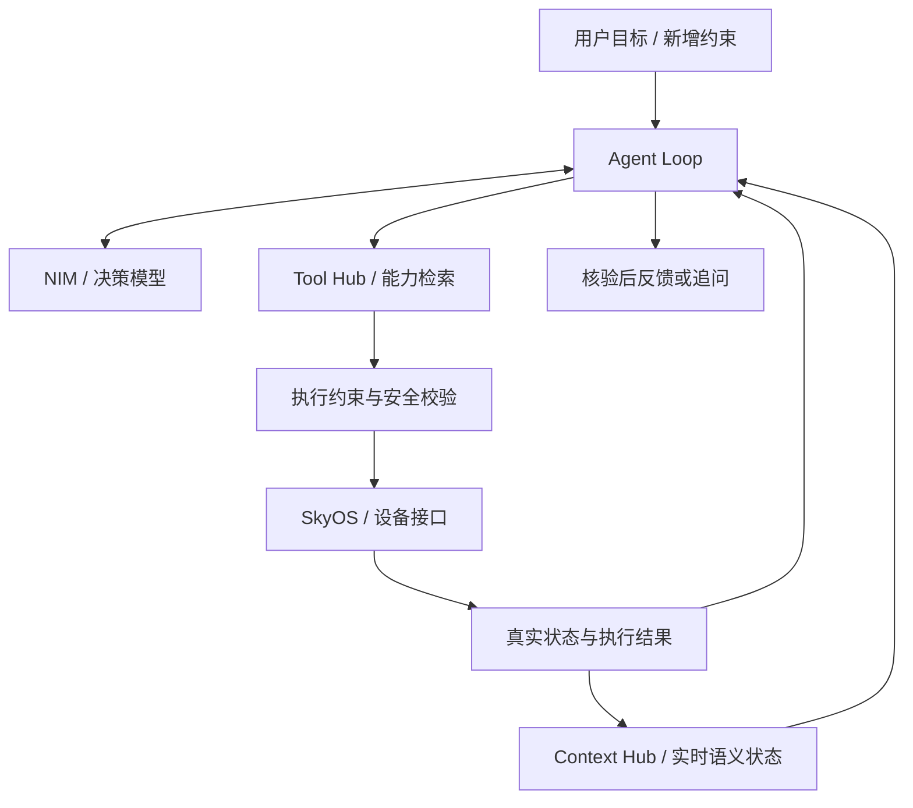
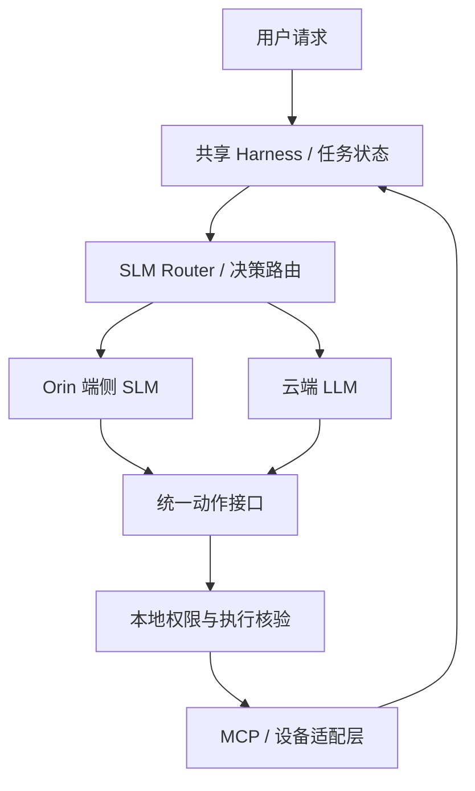

从 NOMI Intelligence 4.0 看车载 Agent Harness：从工具调用到整车自主闭环
2026-11-26 · Agent Architecture / Context Engineering / Edge AI / Harness Engineering

原文：焕然新生，NOMI Intelligence 4.0 即将登场

蔚来在 NOMI Intelligence 4.0 的技术预告中介绍了 NIM 模型矩阵、NIH 智能体运行系统与 SkyOS 的协同架构。相比单纯讨论车载大模型的能力，我更关注的是：当模型成为主任务决策者之后，Harness 应该如何让模型可靠地理解环境、发现能力、执行动作并验证结果？

这与我此前探索的基于 MCP 的车载智能域控 Agent、Orin 端侧小模型部署、端云协同，以及 Codex / DeepSeek Harness 的对比评测有很直接的联系。

本文区分三类内容：蔚来原文披露的设计、我对这些设计的工程推演、以及对自己项目的后续规划。后两者并非蔚来实际实现，也不代表我的项目已经完成相应功能。
1. 核心变化：从意图分发到目标驱动
传统语音架构是 User → NLU/LLM → Intent Router → Workflow → API。即使替换成更强的模型，后面的任务路径仍可能是预先编写的。跨域组合和用户中途改口会带来大量分支及状态同步逻辑。

NOMI 4.0 的思路是让模型根据环境持续决定下一步：工具执行的结果成为下一轮决策的输入，直到目标达成、需要追问或无法继续。这里真正发生变化的是任务编排权，不是所有规则都消失了。确定性的硬件控制、安全校验、权限检查和业务不变量仍然应该由程序负责。

上图是对原文的逻辑重建，不是蔚来官方架构图。对我的车载原型而言，可以将 SkyOS 所在的位置理解为自己的设备适配及执行层，但这不意味着展示性质的 Orin 直控设备方案已经具备生产级整车 OS 的能力。
2. Context Hub：Session State 之外还需要 World State
我此前的 Agent 项目涉及会话状态、长短期记忆和用户画像。NOMI 的 Context Hub 提醒我：物理环境中的 Agent 不仅需要记住用户，更需要准确理解此刻的世界。

原文披露了基于 Ontology 的全域语义表达，将车身、座舱、底盘等信号转为统一语义，并提供车型配置与授权边界。这不必然意味着使用 RDF、OWL 或图数据库；关键是共享实体、属性和关系的语义模型。
状态类型	内容	设计要点
World State	设备、乘员、车况、环境	来源、时间戳、有效期、未知状态
Task State	当前目标、约束、已执行动作	可恢复、支持任务修订
Session State	本轮交互及工具结果	关联任务、控制上下文预算
Memory	用户偏好、历史知识	授权、更新、隔离与隐私
Capability State	当前设备支持的能力	车型、权限和实时可用性

例如用户说“把我这边调暖一点，别影响后排”，系统需要把说话者、座位与空调分区建立关联。仅知道用户偏好 24°C，并不足以确定控制对象。

我希望在现有 MCP 设备适配层之上增加统一语义状态接口。设备事件先进入状态存储，由 Context Builder 根据当前任务选择相关实体，必要时主动刷新状态。模型接收语义快照，而不是所有原始信号。

进一步的问题是 KV Cache：如果每轮都重写 system prompt 中的动态车况，会降低前缀复用机会。可将静态规范保持稳定，把状态快照或变更作为后续消息注入，并通过版本号、TTL 和执行前重新读取来控制一致性。具体缓存收益需要结合推理后端和消息模板实测，不能只根据消息角色推断。
3. Tool Hub：MCP 解决连接，Tool RAG 解决发现
原文提到对约 3,000 项原子能力抽象合并，保留高频常驻工具，并通过名称正则、关键词倒排、向量语义检索动态暴露其余工具。这里的 3,000 项是原子能力，并不等于最终暴露给模型的 3,000 个工具。

对我的 MCP Agent 来说，工具接入与工具发现应该解耦：MCP 提供工具连接和描述的协议，Tool Registry / Tool Search 提供大规模发现与筛选能力，Skill 则封装任务知识和操作经验。蔚来没有披露 Tool Hub 是否采用 MCP，不能将两者直接等同。

建议的工具生命周期：
1. 注册 MCP 工具及设备能力，维护统一 metadata（参数、读写属性、设备、权限、前置条件、错误语义）。
2. 根据当前用户授权和设备配置过滤候选；保留少量高频工具和 search_tools 入口。
3. 结合名称匹配、关键词及语义向量召回，融合排序；按需暴露完整 schema。
4. 由模型选择工具及参数，运行时重新校验，执行后返回结构化结果。
5. 对召回失败、错误选择、参数错误分别记录，形成评测与训练数据。
对于端侧小模型，这种方案减少了工具定义占用，但也引入额外搜索和模型轮次。需要测量 Recall@K、工具选择准确率、参数正确率、输入 token、首动作延迟及端到端成功率，而不是仅比较工具数量。可先用固定工具集作为 baseline，再加入混合检索进行消融。
4. Reliable Execution：调用成功不等于目标达成
NOMI 原文中特别有价值的例子是：车控请求超时，动作可能已经发生，只是回执未返回。此时盲目重试可能造成额外物理副作用。

这与 Coding Agent 执行 shell 命令后需要检查文件和测试结果类似，但物理环境的安全要求更高。我希望在自己的 Harness 中将执行状态与模型文本分开维护：
PROPOSED → VALIDATED → DISPATCHED → ACKNOWLEDGED → VERIFIED
                              ↘ UNKNOWN → RECONCILE
ACKNOWLEDGED 仅表示收到确认；`VERIFIED` 才表示可观测状态满足目标。对于状态未知的动作，应先进行状态核验，不能默认未执行。具备设备侧支持时，可采用幂等请求标识；对于非幂等动作，需要更严格的重试策略与权限约束。

用户中途修改需求时，也需要区分尚未发出的动作、已经在途的动作和已产生的物理结果。可以取消未执行的计划，但不能假定已执行动作会自动回滚。补偿动作必须重新通过安全校验。

我的展示原型不能因此被视为具有生产车辆安全资质；未来验证首先在模拟设备与受控台架中进行，涉及车辆安全关键功能的约束应始终由授权的确定性控制系统强制执行。
5. 端云协同：小模型不只是 Intent Router
我此前探索过在 Orin 上使用 llama.cpp 部署 Qwen 小模型、通过 special token 相关训练改善工具调用表现，以及将复杂请求交给云端模型的设计。NOMI 4.0 给这个方向的启发是：端云协同应该考虑整个 Agent Loop，而不仅是用户输入进入系统时的一次路由。

一种待验证的设计如下：

端侧优先处理明确、低延迟、已知工具的决策；复杂跨域组合、检索失败和不确定任务可按策略升级至云端。两类模型共享任务状态和动作协议，但云端不能绕过本地安全边界。断网时应明确可用能力，不假装所有任务都能完成。

路由策略需要同时评估准确率、失败升级率、P50/P95 时延、端侧资源占用、网络依赖及数据最小化。蔚来原文没有给出 NIM 的模型规模、具体端云路由策略或复杂任务时延，因而不能将上述方案视为其实际设计。

另外，原文宣称全双工模块采用 12.5Hz 流式 Codec、最快 80ms 一次交互决策、对话端到端响应在 1 秒以内。这些是不同指标，并不意味着复杂 Agent 任务可在 80ms 或 1 秒内全部完成。我的项目可以先将交互延迟与任务执行延迟分开度量，再考虑语音打断事件的异步注入。
6. Agentic RL：训练对象从单次调用变成完整轨迹
NOMI 披露的三阶段训练体系分别是全链路 SFT、动作级 RL 和基于座舱仿真环境的 Agentic RL。前两者分别改善示范学习与单步决策，后者强调多步动作的环境后果。具体 RL 算法、奖励权重和训练规模并未公开。

我的车载项目可以先建立一个不依赖真实硬件的可复现环境：用户模拟器负责改口、补充限制；设备模拟器维护状态转移、权限、延迟、超时和失败；Harness 负责执行和记录轨迹。真实台架可用于校准模拟器与验证关键场景。
阶段	建议实施
Evaluation first	固定任务集、环境种子、终态判定与失败注入
SFT	保存完整成功轨迹，训练工具检索、参数生成、后续决策
Action-level RL	对合法性、正确工具、必要追问等决策评分
Agentic RL	在动态模拟环境 rollout，根据实际任务达成与安全约束优化策略

奖励应同时考虑最终任务完成、无效调用、重复追问和合规行为。合理拒绝不可执行任务也应计入正确结果。不能仅奖励模型生成“已完成”的文本，必须由独立环境判定。这里是后续研究路线，不代表我的原型已经进行了上述 RL 训练。
7. Model-Harness 双循环：从模型评测走向系统评测
这与我之前计划对比 DeepSeek Harness、Codex Harness 和自研 Harness 的方向最相关。NOMI 原文提出通过 OTel 与 Langfuse 沉淀可回放轨迹，并把问题归因于模型或 Harness，分别优化。单纯换模型可能掩盖工具 schema、检索器或上下文构建器的缺陷。

建议采用标准化环境适配层，让不同 Harness 面对语义等价的任务及工具，并明确模型 API、系统提示、工具协议、预算和运行环境的差异。不能为了接入统一接口而不知不觉改变某个 Harness 的原生行为。
评测项	目的
固定 Model，比较 Harness	识别运行时、状态与工具系统的贡献
固定 Harness，比较 Model	识别模型决策能力差异
Model × Harness 组合	检查模型与运行底座的交互效应
模块消融	识别 Context Hub、动态检索、执行核验各自收益
故障注入	检验超时、错误结果、权限变化和中途改口

每条 Trace 建议记录 task_id、`model_version`、`harness_version`、状态版本、检索候选、工具参数、执行结果、终态判定和各段时延。日志须脱敏并遵守权限；不要默认记录敏感用户信息。指标包括任务成功率、误执行率、约束遵守率、重复调用率、恢复成功率、token 消耗、延迟及成本。

同一套思想还可以迁移到我此前基于 DB-GPT 二次开发的数据分析 Agent：将数据库 schema、字段映射和数据权限纳入 Context Hub，将 SQL 执行、数据验证、可视化纳入 Tool Hub，最终根据真实查询结果核验目标，而不是仅根据模型生成的 SQL 判断成功。
8. 下一步：把架构思想变成可验证的工程
优先级	交付物	验收方式
P0	统一任务状态、动作协议及设备模拟器	固定种子的任务可重复运行
P0	MCP Registry 与 Tool Search	对比全量工具暴露的召回和成本
P0	执行记录、权限校验、终态核验	超时和重复调用测试
P1	Context Hub 与状态版本管理	过期状态、中途改口、跨设备任务测试
P1	OTel Trace 与多 Harness 评测适配器	轨迹回放、失败归因、可重复指标
P2	Orin/云端决策路由及仿真训练	端云基线对比与闭环训练验证

这篇文章最重要的 takeaway 不是把 NOMI 的模块名称复制到自己的项目，而是理解每个模块解决的具体问题，并用可复现的实验验证实际收益。

在未来的 Agent 体系中，模型是策略，Harness 是组织决策和可靠执行的运行时，Environment 是任务真实结果的来源。只有三者形成闭环，才能从“模型会调用工具”走向“系统能完成目标”。
证据边界：本文基于蔚来官方技术预告及本人此前的项目探索进行解读。原文中的行业领先性、性能指标属于厂商披露，未在本文独立验证；工程架构图、状态机、评测计划与实施路线为分析和建议，尚未据此完成论文查新或实证验证。本文不包含项目源码、企业内部数据或实测指标。
